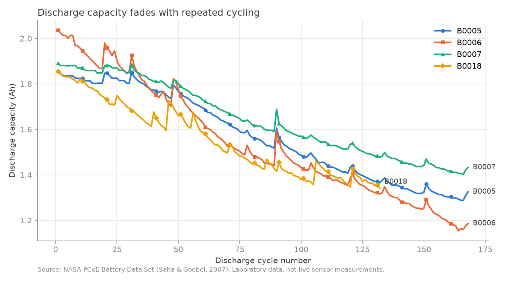
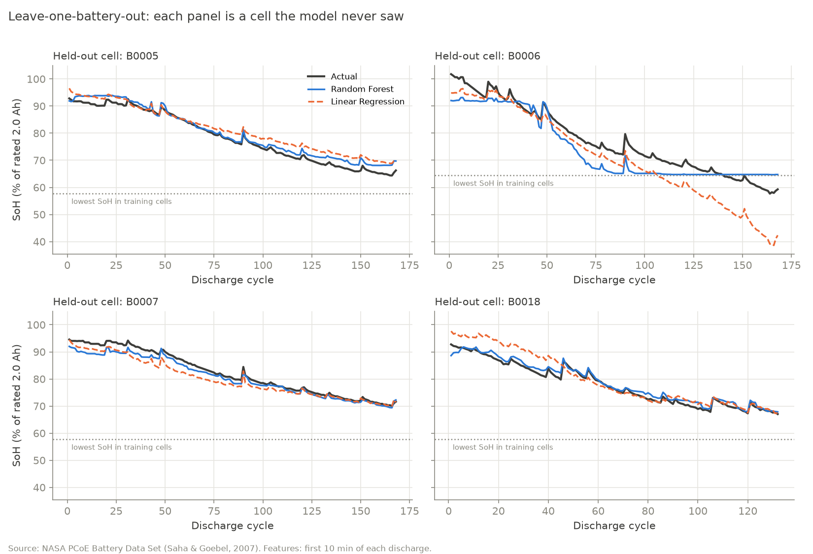

# Smart Energy & Battery Health Monitoring System

An end-to-end prototype combining Machine Learning, IoT sensors, a FastAPI backend,
and a Next.js dashboard for battery health monitoring.

> **Status:** v0.2.0 — dataset pipeline and a State of Health model evaluated on unseen
> cells. Backend, dashboard and hardware integration are planned for later versions.

## Roadmap

| Version | Scope | Status |
|---|---|---|
| v0.1.0 | NASA dataset inspection, preprocessing and degradation plots | Done |
| v0.2.0 | State of Health prediction model with battery-wise evaluation | Done |
| v0.3.0 | FastAPI backend, SQLite database and web dashboard (clearly labeled demo data) | Planned |
| v0.4.0 | Arduino sensor integration (INA219, DS18B20) | Planned |
| v1.0.0 | Integrated, tested and documented portfolio release | Planned |

## State of Health model (v0.2.0)

The model estimates capacity-based State of Health (% of the 2.0 Ah rated capacity) from
**only the first 10 minutes** of a discharge, so it never sees the capacity it predicts.
It was evaluated with **leave-one-battery-out** testing: each cell is predicted by a model
trained on the other three.

| Model | MAE (SoH % points) | RMSE | R² |
|---|---|---|---|
| Mean baseline | 8.68 | 10.09 | −0.03 |
| Linear Regression | 3.54 | 4.88 | 0.76 |
| **Random Forest** | **2.23** | **3.05** | **0.91** |

The hardest cell (B0006) lies partly outside the SoH range of the other cells, where
neither model is reliable. Results apply to NASA laboratory data only. Full details,
figures and limitations: [model/README.md](model/README.md).

## Dataset

NASA PCoE Li-ion Battery Aging Data (B0005, B0006, B0007, B0018).
Download: https://phm-datasets.s3.amazonaws.com/NASA/5.+Battery+Data+Set.zip

Raw files are **not** included in this repository. Place the extracted `.mat` files in
`model/data/raw/`.

Citation: B. Saha and K. Goebel (2007). "Battery Data Set", NASA Prognostics Data Repository,
NASA Ames Research Center, Moffett Field, CA.

## Setup (Windows)

    python -m venv .venv
    .\.venv\Scripts\Activate.ps1
    pip install -r requirements.txt
    python model/scripts/verify_environment.py

## Run the pipeline

    python model/scripts/inspect_dataset.py --save
    python model/scripts/preprocess_data.py
    python model/scripts/plot_capacity.py
    python model/scripts/build_features.py
    python model/scripts/train_soh_model.py
    python model/scripts/evaluate_model.py

## License

Code: MIT License (see [LICENSE](LICENSE)). The NASA dataset is not redistributed here;
see the NASA repository for its terms of use.