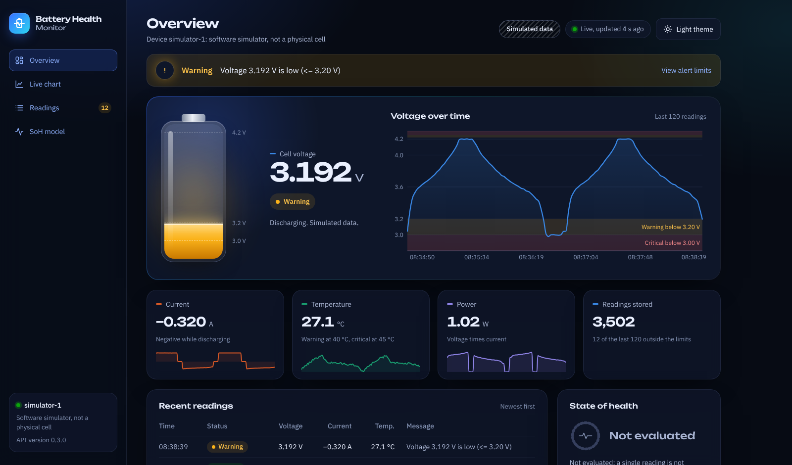
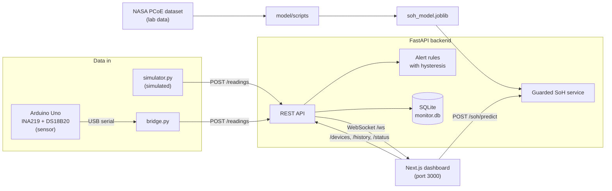

# Smart Energy & Battery Health Monitoring System

An end-to-end prototype that combines Machine Learning, a FastAPI backend, a live web
dashboard and (next) IoT sensors to monitor a lithium-ion cell.

> **Status:** v0.3.0. A State of Health model trained and evaluated on NASA laboratory
> data, a FastAPI backend with alerts and live WebSocket updates, and a web dashboard.
> The dashboard currently runs on **simulated data**; real sensor hardware arrives in v0.4.0.

*The dashboard with simulated readings. Every reading carries its data source, and the
"Simulated data" label stays visible so it is never mistaken for a measurement.*

## What works today

- **Data pipeline** for the NASA PCoE battery aging dataset, with degradation plots.
- **SoH model** (Random Forest) that estimates capacity-based State of Health from the
  first 10 minutes of a discharge, evaluated on cells it never saw during training.
- **Backend** (FastAPI + SQLite): stores readings, decides a normal / warning / critical
  status for each one, and pushes every new reading to connected clients over a WebSocket.
- **Guarded SoH service**: the model only answers inside the conditions it was trained on
  and says "not evaluated" everywhere else.
- **Dashboard** (Next.js + Tailwind + Recharts): live battery graphic, voltage chart with
  alert zones, current, temperature and power, recent readings, a device picker when several devices send data, dark and light
  themes (remembered), phone layout.
- **Simulator** that sends labeled simulated readings in the same format the Arduino
  bridge will use later.

## Architecture

Every reading keeps its `source` (`simulated`, `sensor` or `nasa`) and `device_id` from the
moment it is sent, so the three kinds of data never mix.

## Data sources are kept separate

| Source | Where it comes from | Used for |
|---|---|---|
| NASA lab data | NASA PCoE dataset, cells B0005, B0006, B0007, B0018 | Training and evaluating the SoH model only |
| Simulated data | `backend/simulator.py`, a simple made-up cell model | Developing and demonstrating the backend and dashboard |
| Sensor data | Arduino Uno with INA219 and DS18B20 | Planned for v0.4.0 |

Each stored reading has a `source` field, and the dashboard shows it on screen.

## Roadmap

| Version | Scope | Status |
|---|---|---|
| v0.1.0 | NASA dataset inspection, preprocessing and degradation plots | Done |
| v0.2.0 | State of Health model with battery-wise evaluation | Done |
| v0.3.0 | FastAPI backend, SQLite, live WebSocket updates and web dashboard (simulated data) | Done |
| v0.4.0 | Arduino sensor integration (INA219, DS18B20, relay cut-off) | In progress: bridge, firmware and wiring guide ready, waiting for parts |
| v1.0.0 | Integrated, tested and documented portfolio release | Planned |

## State of Health model

The model estimates capacity-based State of Health (% of the 2.0 Ah rated capacity) from
**only the first 10 minutes** of a discharge, so it never sees the capacity it predicts.
It was evaluated with **leave-one-battery-out** testing: each cell is predicted by a model
trained on the other three.

| Model | MAE (SoH % points) | RMSE | R² |
|---|---|---|---|
| Mean baseline | 8.68 | 10.09 | −0.03 |
| Linear Regression | 3.54 | 4.88 | 0.76 |
| **Random Forest** | **2.23** | **3.05** | **0.91** |

The hardest cell (B0006) lies partly outside the SoH range of the other cells, where
neither model is reliable. Results apply to NASA laboratory data only. Full details,
figures and limitations: [model/README.md](model/README.md).

**In the dashboard**, a single live reading is never turned into an SoH number. The SoH
panel says "Not evaluated" and explains why. A button runs the real model on one NASA
example (cell B0005, discharge 1: estimated 92.4 %, measured 92.8 %); that cell was part of
the training data, so this demonstrates the model running, not its accuracy.

## Quick start (Windows, PowerShell)

**1. Python environment** (project root)

    python -m venv .venv
    .\.venv\Scripts\Activate.ps1
    pip install -r backend/requirements.txt

**2. Create the SoH model** (needs the NASA files in `model/data/raw/`, see Dataset)

    python model/scripts/preprocess_data.py
    python model/scripts/build_features.py
    python model/scripts/train_soh_model.py

The backend still runs without the model; the SoH panel then reports that the model is
not available.

**3. Backend** (terminal 1)

    uvicorn app.main:app --app-dir backend --reload --reload-dir backend

API documentation: http://127.0.0.1:8000/docs

**4. Dashboard** (terminal 2, needs Node.js 20 or newer)

    cd frontend
    npm install
    npm run dev

Open http://localhost:3000

**5. Simulated readings** (terminal 3)

    .\.venv\Scripts\Activate.ps1
    python backend/simulator.py --speed 300

**6. Tests** (optional)

    pip install -r backend/requirements-dev.txt
    python -m pytest backend

GitHub Actions runs the same tests, a lint and production build of the dashboard, and an
Arduino Uno compile of the firmware on every push. The 5 tests that need the trained model
are skipped there, because the model file is not stored in Git.

More detail: [backend/README.md](backend/README.md), [frontend/README.md](frontend/README.md),
[firmware/README.md](firmware/README.md) and the hardware guide
[docs/hardware/wiring.md](docs/hardware/wiring.md).

## Known limitations

- The simulator is a simple, made-up cell model. Its numbers show how the system behaves;
  they are not measurements.
- The SoH model is validated only for NASA-style 2 A constant-current discharges. The
  planned hardware load draws about 0.4 A, so the model is **not** validated for this
  project's own sensor data.
- Alert thresholds are demonstration values, not certified safety limits.
- Single-user local prototype: no authentication, and the API only accepts browser
  requests from `localhost:3000`.
- Database calls inside the async `POST /readings` endpoint run synchronously. This is fine
  for one device at a few readings per second.

## Dataset

NASA PCoE Li-ion Battery Aging Data (B0005, B0006, B0007, B0018).
Download: https://phm-datasets.s3.amazonaws.com/NASA/5.+Battery+Data+Set.zip

Raw files are **not** included in this repository. Place the extracted `.mat` files in
`model/data/raw/`.

Citation: B. Saha and K. Goebel (2007). "Battery Data Set", NASA Prognostics Data Repository,
NASA Ames Research Center, Moffett Field, CA.

## License

Code: MIT License (see [LICENSE](LICENSE)). The NASA dataset is not redistributed here;
see the NASA repository for its terms of use.
