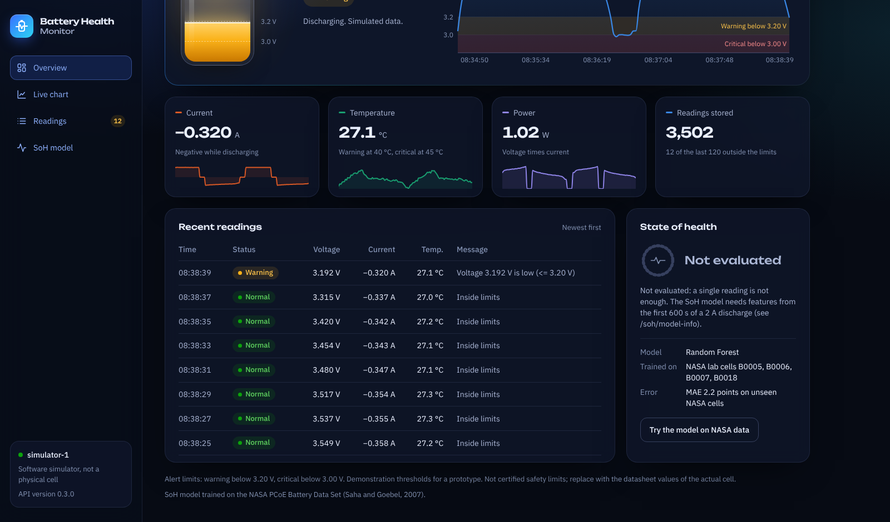

# Dashboard

Next.js web dashboard for the battery monitor. It loads recent readings from the backend,
then updates live over the WebSocket.

## Run

The backend must be running first (see [../backend/README.md](../backend/README.md)).

    cd frontend
    npm install
    npm run dev

Open http://localhost:3000

The backend address defaults to `http://127.0.0.1:8000`. To use another address, create
`frontend/.env.local` with:

    NEXT_PUBLIC_API_URL=http://192.168.1.50:8000

and add that dashboard address to `FRONTEND_ORIGINS` in `backend/app/main.py`.

Production build check:

    npm run build
    npm run lint

## What is on the page



| Part | Shows |
|---|---|
| Header | Device picker (when more than one device sends data), data source label, live connection state, theme switch |
| Status banner | The status and message the backend's alert service gave the latest reading |
| Battery graphic | Where the voltage sits on a 2.8 to 4.3 V scale, with the alert zones shaded. It is **not** state of charge |
| Voltage chart | The last 120 readings with warning and critical bands; hover for exact values |
| Tiles | Current, temperature, power (voltage times current) and the number of readings stored for the shown device |
| Recent readings | The newest 8 readings with their status |
| State of health | "Not evaluated" for live readings, the model's details, and a button that runs the model on one NASA example |
| Measured capacity | For sensor data: mAh delivered in the latest discharge, how it ended, and a measured State of Health only when the run went from full to the cut-off. For simulated data it explains why nothing is measured |

If the backend stops, the header shows "Offline, reconnecting" and the page reconnects on
its own, filling any gap from `/history`.

## Structure

```
frontend/
├── app/
│   ├── layout.tsx        fonts, page title, applies the saved theme before drawing
│   ├── globals.css       brand colors (dark and light) as CSS variables
│   ├── page.tsx          renders the dashboard
│   └── icon.svg          browser tab icon
├── components/           one file per part of the page
├── hooks/
│   ├── useBatteryData.ts devices, per-device history + live WebSocket + reconnect
│   ├── useTheme.ts       current theme, saved in the browser
│   └── useNow.ts         ticking clock for "updated 3 s ago"
└── lib/
    ├── api.ts            backend types and requests
    ├── format.ts         number, time and status formatting
    └── theme.ts          chart colors per theme, theme start-up script
```

## Design notes

- Brand: Cobalt `#3B6CFF` to Ion `#2FD4F0`. Fonts: Unbounded (headings and readouts) and
  IBM Plex Sans (text), installed from npm so they work without Google Fonts.
- Green, amber and red are used only for status, always with a text label, never alone.
- One color per measured quantity: voltage blue, current orange, temperature green, power
  violet.
- The data source is always visible: hatched chip for simulated data, solid for sensor
  data, outlined for NASA lab data.
- The only continuous animations (battery shimmer, live dot) stop when the system setting
  "reduce motion" is on.

## Known limitations

- The selected device is not remembered after a reload; the page then shows the most
  recently active device.
- Times on the chart are the server's clock. The simulator compresses time (for example
  300x), so one minute on the chart can hold several simulated hours.
