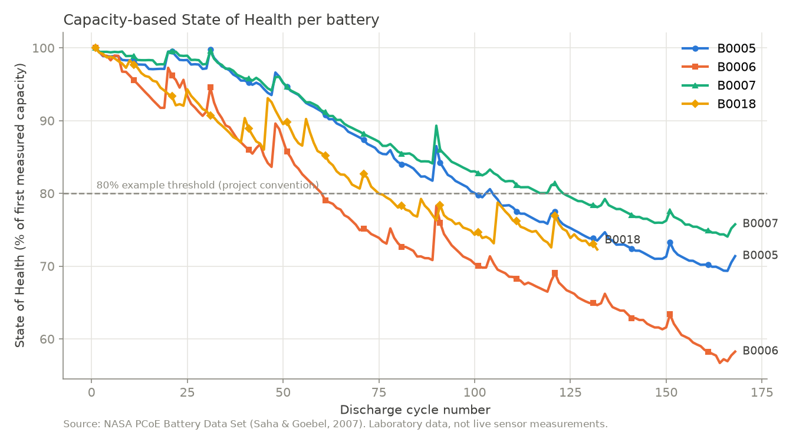
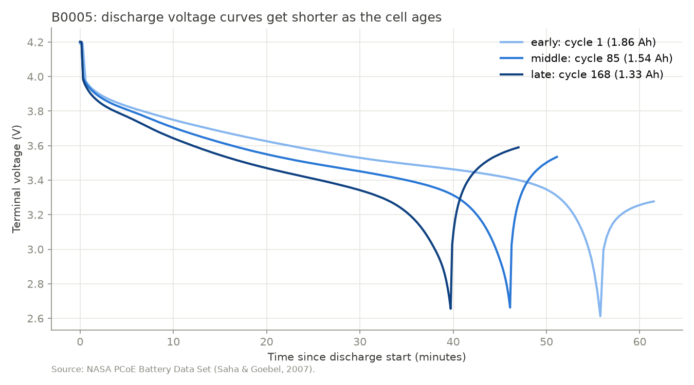

# Model: Dataset Pipeline (Stage 1)

This folder contains the data pipeline for the NASA lithium-ion battery aging dataset:
inspection, preprocessing into a per-cycle table, and degradation plots.

> All results in this folder come from **NASA laboratory data** (historical, 2008).
> They are not live sensor measurements and do not describe any other battery.

## 1. Data source

| Item | Value |
|---|---|
| Dataset | NASA PCoE "Battery Data Set" (cells B0005, B0006, B0007, B0018) |
| Repository | [NASA Prognostics Center of Excellence Data Set Repository](https://www.nasa.gov/intelligent-systems-division/discovery-and-systems-health/pcoe/pcoe-data-set-repository/) |
| Download | https://phm-datasets.s3.amazonaws.com/NASA/5.+Battery+Data+Set.zip |
| Citation | B. Saha and K. Goebel (2007). "Battery Data Set", NASA Prognostics Data Repository, NASA Ames Research Center, Moffett Field, CA. |

The raw `.mat` files are **not** stored in this repository. To reproduce:

1. Download the zip above and extract it (it contains further zip files).
2. Copy `B0005.mat`, `B0006.mat`, `B0007.mat`, `B0018.mat` and `README.txt`
   into `model/data/raw/`.

## 2. Test protocol (from the NASA README)

- Commercial Li-ion 18650 cells, tested at room temperature (files record 24 °C ambient).
- **Charge:** constant current 1.5 A until 4.2 V, then constant voltage until current drops to 20 mA.
- **Discharge:** constant current 2 A until the voltage falls to a cut-off that differs per cell:

  | Cell | Cut-off voltage (README) | Median minimum voltage measured |
  |---|---|---|
  | B0005 | 2.7 V | 2.660 V |
  | B0006 | 2.5 V | 2.429 V |
  | B0007 | 2.2 V | 2.102 V |
  | B0018 | 2.5 V | 2.415 V |

- **Impedance:** EIS sweep from 0.1 Hz to 5 kHz.
- **Stop criterion stated by NASA:** 30% fade in rated capacity (2 Ah → 1.4 Ah).

## 3. File structure (verified with `inspect_dataset.py`)

| Cell | Records | Charge | Discharge | Impedance |
|---|---|---|---|---|
| B0005 | 616 | 170 | 168 | 278 |
| B0006 | 616 | 170 | 168 | 278 |
| B0007 | 616 | 170 | 168 | 278 |
| B0018 | 319 | 134 | 132 | 53 |

Discharge measurement fields and units:

| Field | Unit | Meaning |
|---|---|---|
| `Voltage_measured` | V | Battery terminal voltage |
| `Current_measured` | A | Battery output current |
| `Temperature_measured` | °C | Battery temperature |
| `Current_load` | A | Current measured at the load |
| `Voltage_load` | V | Voltage measured at the load |
| `Time` | s | Time since the start of the cycle |
| `Capacity` | Ah | Discharge capacity (one value per cycle) |

## 4. How to run

From the project root, with the virtual environment active:

    python model/scripts/inspect_dataset.py --save
    python model/scripts/preprocess_data.py
    python model/scripts/plot_capacity.py

| Script | Output |
|---|---|
| `inspect_dataset.py` | `model/reports/inspection_report.txt` |
| `preprocess_data.py` | `model/data/processed/discharge_cycles.csv`, `model/reports/preprocessing_log.txt` |
| `plot_capacity.py` | three PNG figures in `model/reports/figures/` |

## 5. Preprocessing

One row per **discharge** cycle. A cycle is skipped (and logged) if a required field
is missing, its arrays have different lengths, it has fewer than 10 samples, it
contains NaN values, or its capacity is not a positive number.

Result on the real data: **636 discharge cycles kept, 0 skipped.**

Main output columns:

| Column | Description |
|---|---|
| `battery_id`, `discharge_cycle` | Cell and 1-based discharge counter |
| `start_time`, `ambient_temperature_c` | Cycle start and ambient temperature |
| `capacity_ah` | Discharge capacity reported by NASA |
| `duration_s` | Length of the recorded discharge cycle |
| `voltage_start_v`, `voltage_min_v`, `voltage_mean_v` | Voltage summary |
| `current_mean_a` | Mean of `Current_measured` |
| `temperature_*` | Start, max, mean, rise, and time to max temperature |
| `re_ohm_last`, `rct_ohm_last` | Most recent impedance values before this discharge (empty before the first impedance test) |
| `soh_pct` | Capacity / first measured capacity of the same cell × 100 |
| `soh_rated_pct` | Capacity / 2.0 Ah rated capacity × 100 |

### State of Health definition

    soh_pct       = capacity_ah / first valid discharge capacity of the same cell × 100
    soh_rated_pct = capacity_ah / 2.0 Ah × 100

These are **operational definitions for this project**, not a universal battery-health
standard. `soh_pct` is used for the figures because the cells started at different
capacities (1.855–2.035 Ah).

## 6. Results

| Cell | Discharge cycles | First capacity | Last capacity | Lowest `soh_pct` | Reached 1.4 Ah? |
|---|---|---|---|---|---|
| B0005 | 168 | 1.856 Ah | 1.325 Ah | 69.3% | Yes |
| B0006 | 168 | 2.035 Ah | 1.186 Ah | 56.7% | Yes |
| B0007 | 168 | 1.891 Ah | 1.432 Ah | 74.1% | **No** (lowest ≈ 1.400 Ah) |
| B0018 | 132 | 1.855 Ah | 1.341 Ah | 72.3% | Yes |

## 7. Observations and limitations

1. **Different cut-off voltages.** Each cell was discharged to a different voltage,
   so the four cells are not identical experiments. This matters when a model trained
   on some cells is tested on another.
2. **Capacity regeneration.** Capacity sometimes jumps up for a few cycles (for example
   near cycles 20, 30, 47, 89, 120 and 150), most likely after rest periods. These points
   are kept, not removed as outliers. It means a cell can drop below a threshold and
   briefly rise above it again.
3. **Rest period inside the discharge record.** After the cut-off voltage is reached,
   the voltage recovers while recording continues. `duration_s` and `voltage_mean_v`
   therefore include a short rest period.
4. **Target leakage warning.** With constant-current discharge, `duration_s` is almost a
   direct function of capacity. It must not be used as an input when predicting
   capacity-based SoH.
5. **B0007 never reached NASA's 1.4 Ah end-of-life level** in the recorded data, although
   the README says the experiments stopped at that criterion. Its full remaining-useful-life
   label under that definition is therefore unknown and must not be invented.
6. **README vs. file differences.** The NASA README lists discharge fields as
   `Current_charge` / `Voltage_charge`, but the files contain `Current_load` /
   `Voltage_load`. The README also says capacity is "for discharge till 2.7 V", while the
   cut-off differs per cell; this could not be verified from the files.
7. **Sign convention.** `Current_load` is positive for B0018 and negative for the other
   cells, so the pipeline uses `Current_measured`.
8. **Small sample.** Four cells of one type, tested in one lab under room-temperature
   conditions. Results do not generalize to other chemistries, cell designs or real-world
   operating conditions.
9. **Missing impedance values.** `re_ohm_last` / `rct_ohm_last` are empty for 57 early
   discharge rows (about the first 19 discharges of B0005, B0006 and B0007), because no
   impedance test had been run yet.